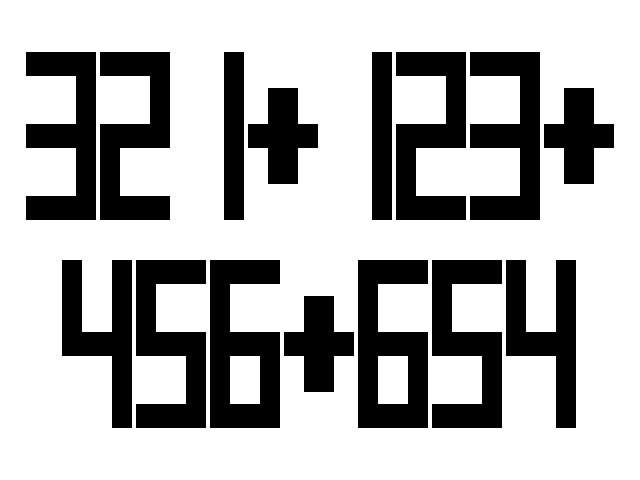

# Hand truck

基于 STM32F407VGTx、STM32 HAL 和 FreeRTOS 的控制板工程，使用 Keil 构建。

## 当前版本

当前功能分支包含串口屏分批绘制修复与七段粗体显示优化：

- 上电后串口屏全白，等待数据。
- `321+123` 完整显示在屏幕上半部分。
- `321+123+456+654` 上半行显示 `321+123+`，下半行显示 `456+654`。
- 数字按字符分批绘制，每批等待处理时间，避免超长指令导致字符缺失。
- 数字采用七段粗体，实际笔画高度 84 像素，按 0.153 mm 像素间距换算为 12.852 mm。
- 大数字模式每行最多 8 字符，共两行；超过 16 字符仍沿用原有普通文字路径。
- 连续相同数据不清屏、不发送绘图指令；字符位置相同时，只重画变化字符。
- 行长度变化时，只清除并重画该行；清屏、外部绘图或部分绘制失败后，会重新恢复完整画面。

主机模拟等待对比：`321+123` 从 2970 ms 降至 1370 ms，双行示例从 5770 ms 降至 2870 ms；只将最后一位 `3` 改为 `4` 时为 200 ms。上述数值为同一测试环境下的协议等待预算，不包含真实串口传输开销，实际显示速度需烧录后确认。



## 工程与固件

- `Hand truck.ioc`：STM32CubeMX 配置。
- `MDK-ARM/HAND TRUCK.uvprojx`：Keil 工程。
- `Core/`：应用与板级代码。
- `Drivers/`、`Middlewares/`：STM32 驱动、CMSIS 和 FreeRTOS，保留各目录中的许可证文件。
- `firmware/HAND_TRUCK.hex`：2026-10-31 编译的当前固件；本次已编译生成，尚未完成烧录后的屏幕实测。
- `DISPLAY_REQUIREMENTS.md`：已记录的显示要求。
- `docs/superpowers/`：已确认设计、修改计划和验证记录。

## 构建与验证

用 Keil 打开 `MDK-ARM/HAND TRUCK.uvprojx`，构建 `Hand truck` 目标。当前本机使用 ARMCLANG V6.16，构建结果为 0 错误、4 条已有警告；工程文件原先记录的编译器版本为 V6.24，请根据本机安装情况选择。

安装 Python 和 GCC 后，在工程根目录执行主机回归测试：

```sh
python tests/run_jc014_tests.py
```

回归检查覆盖七段字形、实际字高、上下布局、指令长度、发送等待、重复数据、局部刷新和 UART 错误恢复。主机测试不能代替烧录后的实物验证。

编译缓存、构建日志和本机调试配置不纳入版本控制。
